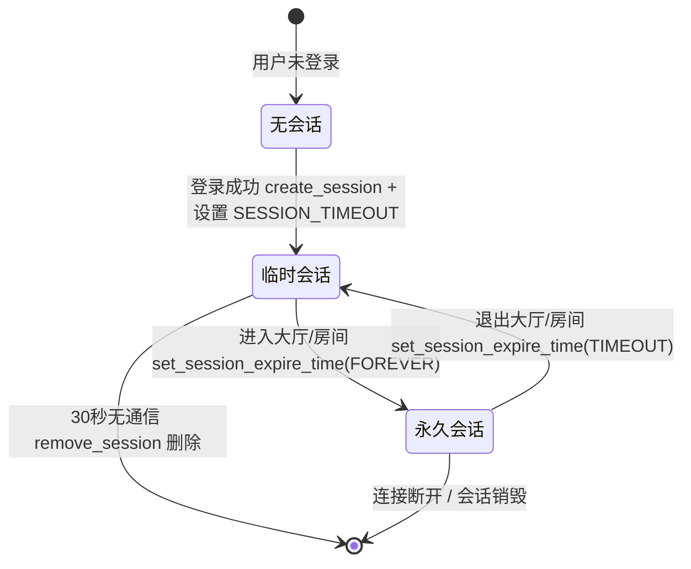

# 会话模块设计

## 1. 模块设计思路

### 1.1 为什么需要会话

HTTP 协议本身**无状态**，用户登录、注册等 HTTP 请求完成后，服务器需要记住「这个用户已登录」这一状态；同时，用户在 WebSocket 长连接中的一系列操作也需要关联到具体的用户身份。因此需要一个**会话（session）**来承载用户在一次登录周期内的状态信息。

### 1.2 会话中需要保存的数据

| 数据 | 字段 | 说明 |
| ---- | ---- | ---- |
| 会话唯一标识符 | `_ssid` | 区分不同的会话 |
| 关联用户 ID | `_uid` | 标识该会话属于哪个用户 |
| 登录状态 | `_status` | 区分「未登录 / 已登录」 |
| 关联定时器 | `_tp` | 用于会话生命周期的超时管理 |

### 1.3 会话生命周期管理思路

- 在 HTTP 通信阶段（登录、注册），会话应具有**生命周期**，指定时间无通信后删除；
- 在客户端建立 WebSocket 长连接（进入游戏大厅 / 游戏房间）时，会话应**永久存在**；
- 登录后创建会话，会话需要在指定时间无通信后删除；
- 进入游戏大厅或游戏房间时，会话永久存在；
- 退出游戏大厅或游戏房间时，会话重新设置为临时，长时间无通信后删除。

## 2. 会话模块的封装实现

- 涉及文件：`session.hpp`
- 依赖：`logger.hpp`、websocketpp（`websocket_server` 及其定时器接口）

### 2.1 会话状态的枚举定义

```cpp
typedef enum
{
    UNLOGIN, // 未登录状态
    LOGIN    // 已登录状态
} ss_status;
```

### 2.2 常量与类型定义

```cpp
#define SESSION_TIMEOUT 30000  // 会话默认超时时间(毫秒)，30秒无通信则删除会话
#define SESSION_FOREVER -1     // 会话永久存在的标记
using session_ptr = std::shared_ptr<session>; // 会话使用智能指针管理，便于自动释放
```

### 2.3 session 类的设计（单个会话）

```cpp
class session
{
    private:
        uint64_t _ssid;                  // session的唯一标识符
        uint64_t _uid;                   // session对应的用户id
        ss_status _status;               // 用户状态
        websocket_server::timer_ptr _tp; // session关联的定时器

    public:
        session(uint64_t ssid);          // 构造函数：初始化 _ssid，默认 UNLOGIN
        ~session();                      // 析构函数
        uint64_t get_ssid();             // 获取会话ID
        void set_statu(ss_status statu); // 设置会话状态
        void set_user(uint64_t uid);     // 绑定用户ID
        uint64_t get_user();             // 获取绑定的用户ID
        bool is_login();                 // 判断是否已登录（_status == LOGIN）
        void set_timer(const websocket_server::timer_ptr &tp); // 设置关联定时器
        websocket_server::timer_ptr &get_timer();              // 获取关联定时器
};
```

实现细节：

- 构造函数将 `_ssid` 置为传入值、`_status` 默认置为 `UNLOGIN`，并打印 `SESSION %p 被创建!` 日志。
- 析构函数打印 `SESSION %p 被释放!` 日志，方便观察会话的创建与销毁。

### 2.4 session_manager 类的设计（会话管理器）

```cpp
class session_manager
{
    private:
        uint64_t _next_ssid;                                // ssid计数器（从1开始自增）
        std::mutex _mutex;                                  // 互斥锁，保护会话增删查
        std::unordered_map<uint64_t, session_ptr> _sessions;// 会话管理器：ssid -> session
        websocket_server *_server;                          // websocket_server句柄，用于添加定时任务

    public:
        session_manager(websocket_server *server);  // 构造函数
        ~session_manager();                         // 析构函数
        session_ptr create_session(uint64_t uid, ss_status statu); // 创建新会话
        session_ptr get_session_by_ssid(uint64_t ssid);           // 通过会话ID获取会话
        void append_session(const session_ptr &ssp);              // 将会话重新插入管理器
        void remove_session(uint64_t ssid);                       // 通过会话ID删除会话
        void set_session_expire_time(uint64_t ssid, int msec);    // 设置会话过期时间
};
```

## 3. 实现要点

### 3.1 线程安全

所有涉及 `_sessions` 增删查的接口内部均使用 `std::unique_lock<std::mutex>` 加锁，防止多线程下会话管理的并发问题。

### 3.2 会话的创建（create_session）

为指定 `uid` 创建会话，`ssid` 由 `_next_ssid` 计数器自增分配（初始为 1，保证唯一）：

1. 加锁；
2. `new session(_next_ssid)` 创建会话对象，设置状态 `statu` 与用户 `uid`；
3. 以 `(ssid, session_ptr)` 形式插入 `_sessions` 哈希表；
4. `_next_ssid++` 并返回 `session_ptr`。

### 3.3 会话的获取与删除

- **`get_session_by_ssid`**：通过 `ssid` 在哈希表中查找会话；未找到时返回**空 `session_ptr`**，供调用方判空处理。
- **`remove_session`**：通过 `ssid` 从哈希表中删除会话；该函数同时作为**定时器的回调**，会话超时后由服务器自动触发删除。

### 3.4 会话生命周期管理（set_session_expire_time）

该接口依赖 `websocket_server` 的定时器功能完成会话生命周期的管理。先取出会话，再针对「会话当前是否有定时器 `tp`」与「目标 `msec` 是否为 `SESSION_FOREVER`」的**四种组合**分别处理：

| 情况 | 当前有定时器 | msec | 处理逻辑 |
| ---- | ------------ | ---- | -------- |
| 一 | 无 | `SESSION_FOREVER` | 会话保持永久存在，不做处理，直接返回 |
| 二 | 无 | 普通毫秒数 | 会话由「永久」转为「定时删除」：设置一个 `msec` 毫秒后执行 `remove_session` 的定时任务，并保存到会话中 |
| 三 | 有 | `SESSION_FOREVER` | 会话由「定时删除」转为「永久」：`cancel` 旧定时器 → 通过 `_server->set_timer(0, append_session)` 将会话**重新插入** `_sessions`（覆盖可能残留的删除回调）→ 清空会话关联的定时器 |
| 四 | 有 | 普通毫秒数 | **重置**删除时间：`cancel` 旧定时器 → 重新插入会话防止误删 → 清空旧定时器 → 再设置一个新的 `msec` 毫秒后删除的定时任务 |

```cpp
void set_session_expire_time(uint64_t ssid, int msec)
{
    session_ptr ssp = get_session_by_ssid(ssid);
    if (ssp == nullptr) return;

    websocket_server::timer_ptr tp = ssp->get_timer();
    if (tp.get() == nullptr && msec == SESSION_FOREVER)      // 情况一
    {
        return;
    }
    else if (tp.get() == nullptr && msec != SESSION_FOREVER) // 情况二
    {
        websocket_server::timer_ptr tmp_tp =
            _server->set_timer(msec, std::bind(&session_manager::remove_session, this, ssid));
        ssp->set_timer(tmp_tp);
    }
    else if (tp.get() != nullptr && msec == SESSION_FOREVER) // 情况三
    {
        tp->cancel();                                       // 取消可能并不立即生效
        ssp->set_timer(websocket_server::timer_ptr());      // 清空定时器
        _server->set_timer(0, std::bind(&session_manager::append_session, this, ssp));
    }
    else if (tp.get() != nullptr && msec != SESSION_FOREVER) // 情况四
    {
        tp->cancel();
        _server->set_timer(0, std::bind(&session_manager::append_session, this, ssp));
        ssp->set_timer(websocket_server::timer_ptr());
        websocket_server::timer_ptr tmp_tp =
            _server->set_timer(msec, std::bind(&session_manager::remove_session, this, ssp->get_ssid()));
        ssp->set_timer(tmp_tp);
    }
}
```

### 3.5 定时器取消的注意事项

- websocket_server 定时器的 `cancel()` 操作**并不保证立即生效**，定时任务可能仍会执行；
- 因此从「定时删除」状态切换时，不能仅 `cancel` 定时器，必须通过 `set_timer(0, ...)` 将 session **重新插入** `_sessions`（`append_session`），用新任务覆盖可能残留的删除回调，确保会话不会被误删。

## 4. 会话状态迁移流程



| 阶段 | 触发动作 | 处理 |
| ---- | -------- | ---- |
| HTTP 登录 | 登录成功 | `create_session(uid, LOGIN)` + `set_session_expire_time(ssid, SESSION_TIMEOUT)`，30 秒无通信自动删除 |
| HTTP 信息获取 | `GET /info` | 每次成功访问后刷新超时时间（续期 30 秒） |
| 进入游戏大厅 / 房间 | WebSocket 连接建立 | `set_session_expire_time(ssid, SESSION_FOREVER)`，转为永久存在 |
| 退出游戏大厅 / 房间 | WebSocket 连接断开 | `set_session_expire_time(ssid, SESSION_TIMEOUT)`，转为临时，长时间无通信后删除 |
| 断开连接 / 会话超时 | — | `remove_session` 被触发，会话从管理器中移除并释放 |

> 说明：实际代码中**仅登录成功**会创建会话（`server.hpp` 的 `login` 处理中调用 `create_session`）；注册流程不创建会话，注册成功后客户端需重新走登录流程。

## 5. 涉及文件与依赖

- 涉及文件：`session.hpp`
- 依赖：
  - `logger.hpp`（日志输出）
  - websocketpp：`websocket_server`（`websocketpp::server<config::asio>`）及其定时器接口（`set_timer`、`timer_ptr`）
