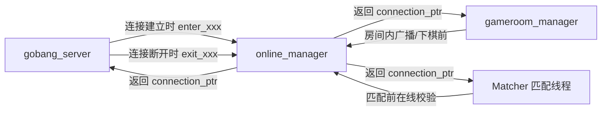

# 在线用户管理模块设计

## 1. 模块设计思路

### 1.1 管理的两类用户

在线用户管理模块只管理**建立了 WebSocket 长连接**的用户，分为两类：

| 类别 | 对应场景 | 存储结构 |
| ---- | -------- | -------- |
| 游戏大厅用户 | 进入游戏大厅的玩家 | `_hall_users` |
| 游戏房间用户 | 进入游戏房间的玩家 | `_room_users` |

> 原因：只有进入大厅 / 房间的用户才会与服务器建立 WebSocket 长连接（普通 HTTP 请求是短连接，无需管理）。因此「用户是否在线」等价于「用户是否出现在这两个映射表中」。

### 1.2 管理的内容

将**用户 ID** 与对应的 **WebSocket 连接（connection）** 关联起来，即 `unordered_map<uint64_t, connection_ptr>`。

### 1.3 作用

1. **定向发送消息**：当房间内一个用户发送消息（下棋 / 聊天）时，通过用户 ID 在模块中查找到该用户对应的 WebSocket 连接，向指定用户的客户端发送消息（房间内广播正是依赖这一点）。
2. **判断在线状态**：通过判断用户是否出现在管理模块中，来确定用户当前是否在线（匹配前的在线校验、对局中判断对方是否掉线都依赖这一点）。

## 2. 在线用户管理模块的封装实现

- 涉及文件：`online.hpp`
- 依赖：`util.hpp`、websocketpp（`websocket_server::connection_ptr`）

```cpp
class online_manager
{
    private:
        std::mutex _mutex; // 互斥锁，保护在线用户增删查操作的线程安全
        // 存储游戏大厅中用户ID与WebSocket连接的映射关系
        std::unordered_map<uint64_t, websocket_server::connection_ptr> _hall_users;
        // 存储游戏房间中用户ID与WebSocket连接的映射关系
        std::unordered_map<uint64_t, websocket_server::connection_ptr> _room_users;

    public:
        void enter_gamehall(uint64_t uid, websocket_server::connection_ptr &conn); // 用户进入游戏大厅
        void enter_gameroom(uint64_t uid, websocket_server::connection_ptr &conn); // 用户进入游戏房间
        void exit_gamehall(uint64_t uid);  // 用户退出游戏大厅
        void exit_gameroom(uint64_t uid);  // 用户退出游戏房间
        bool is_in_gamehall(uint64_t uid); // 判断用户是否在游戏大厅
        bool is_in_gameroom(uint64_t uid); // 判断用户是否在游戏房间
        websocket_server::connection_ptr get_conn_gamehall(uint64_t uid); // 获取大厅中用户连接
        websocket_server::connection_ptr get_conn_gameroom(uint64_t uid); // 获取房间中用户连接
};
```

## 3. 各接口的实现要点

### 3.1 线程安全

所有接口内部均使用 `std::unique_lock<std::mutex>` 加锁，防止多线程下在线用户增删查的并发问题。

### 3.2 进入与退出

| 接口 | 触发时机 | 实现 |
| ---- | -------- | ---- |
| `enter_gamehall` | WebSocket 连接建立（进入大厅） | 加锁后将 `(uid, conn)` 写入 `_hall_users` |
| `enter_gameroom` | WebSocket 连接建立（进入房间） | 加锁后将 `(uid, conn)` 写入 `_room_users` |
| `exit_gamehall` | WebSocket 连接断开（退出大厅） | 加锁后从 `_hall_users` 中 `erase(uid)` |
| `exit_gameroom` | WebSocket 连接断开（退出房间） | 加锁后从 `_room_users` 中 `erase(uid)` |

### 3.3 在线状态判断

- `is_in_gamehall` / `is_in_gameroom`：加锁后在对应哈希表中 `find(uid)`，存在返回 `true`，否则返回 `false`。

### 3.4 连接获取

- `get_conn_gamehall` / `get_conn_gameroom`：加锁后通过 `uid` 查找对应连接；
- 未找到时返回**空 `connection_ptr`**（`websocket_server::connection_ptr()`），供调用方判空处理，避免对空连接调用 `send`。

## 4. 与其他模块的协作



| 调用方 | 使用的接口 | 用途 |
| ------ | ---------- | ---- |
| `gobang_server::wsopen_gamehall` | `enter_gamehall` / `is_in_*` | 大厅连接建立时登记；`is_in_*` 用于**防重复登录**检查 |
| `gobang_server::wsopen_gameroom` | `enter_gameroom` / `is_in_*` | 房间连接建立时登记；防重复登录检查 |
| `gobang_server::wsclose_*` | `exit_gamehall` / `exit_gameroom` | 连接断开时移除在线记录 |
| `gameroom::handle_chess` | `is_in_gameroom` | 下棋前检查对方是否掉线（掉线则直接判胜） |
| `gameroom::broadcast` | `get_conn_gameroom` | 向白 / 黑双方连接发送广播消息 |
| `Matcher::handle_match` | `get_conn_gamehall` | 匹配前校验双方是否仍在线，并向双方发送匹配成功响应 |

## 5. 涉及文件与依赖

- 涉及文件：`online.hpp`（`online_manager` 类）
- 依赖：
  - `util.hpp`（日志头文件等）
  - websocketpp：`websocket_server::connection_ptr`（`websocketpp::server<config::asio>::connection_ptr`）
  - C++ 标准库：`<unordered_map>`、`<mutex>`