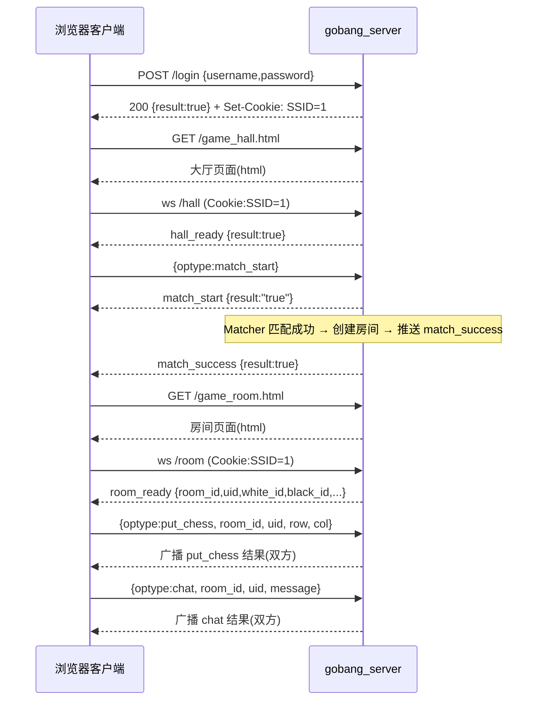

# 封装服务器模块设计（服务器整合）

## 1. 模块概述

服务器整合模块是整个五子棋项目的**总控入口**，将各子模块（会话、数据管理、在线用户、游戏房间、匹配、工具）统一组织起来，基于 **websocketpp** 搭建 WebSocket 服务器，完成以下两大职责：

1. **网络通信接口（协议）设计**：约定「收到什么格式的数据 → 代表什么请求 → 做什么业务处理 → 返回什么响应」。
2. **搭建服务器**：处理 HTTP 与 WebSocket 两类请求，根据请求内容分发给各模块完成业务处理并返回响应。

- 涉及文件：`server.hpp`（`gobang_server` 类）、`gobang.cc`（程序入口）
- 依赖：`db.hpp`、`gameroom.hpp`、`matcher.hpp`、`online.hpp`、`session.hpp`、`util.hpp`、`logger.hpp`、websocketpp

## 2. 模块设计思路

- **为什么需要整合层**：其余模块（会话、匹配、房间……）各自独立，需要有一个统一的入口把它们串联起来，接收客户端请求并驱动各模块协作。
- **两条通信通道**：
  - **HTTP 通道**：承载「页面获取、注册、登录、获取用户信息」等一次性请求（无状态）。
  - **WebSocket 通道**：承载「游戏大厅、游戏房间」的实时长连接通信（下棋、聊天、匹配）。
- **用户身份的识别**：HTTP 无状态，因此登录成功后服务器创建会话，并把会话 ID 通过 `Set-Cookie: SSID=xxx` 交给浏览器；后续所有 HTTP / WebSocket 请求都携带该 Cookie，服务器解析出 `SSID` → 查会话 → 得到用户 ID。
- **静态资源**：游戏页面（`login.html` / `register.html` / `game_hall.html` / `game_room.html`）存放在 `./wwwroot/` 下，由服务器直接读取返回。

## 3. 客户端请求接口总览

### 3.1 HTTP 请求（一次性、无状态）

| # | 客户端动作 | 方法与路径 | 服务器处理函数 |
| - | ---------- | ---------- | -------------- |
| 1 | 获取注册页面 | `GET /register.html` | `file_handler` |
| 2 | 提交注册（用户名 + 密码） | `POST /reg` | `reg` |
| 3 | 获取登录页面 | `GET /login.html` | `file_handler` |
| 4 | 提交登录（用户名 + 密码） | `POST /login` | `login` |
| 5 | 登录成功，获取游戏大厅页面 | `GET /game_hall.html` | `file_handler` |
| 6 | 获取用户信息（展示玩家信息） | `GET /info` | `info` |

### 3.2 WebSocket 请求（长连接、实时）

| # | 客户端动作 | 连接 / 消息 | 服务器处理函数 |
| - | ---------- | ----------- | -------------- |
| 7 | 建立游戏大厅长连接 | `ws://.../hall`（open） | `wsopen_gamehall` |
| 8 | 发起对战匹配 | `{"optype":"match_start"}` | `wsmessage_gamehall` → `Matcher::add` |
| 9 | 停止对战匹配 | `{"optype":"match_stop"}` | `wsmessage_gamehall` → `Matcher::del` |
| 10 | 匹配成功，获取游戏房间页面 | `GET /game_room.html` | `file_handler` |
| 11 | 建立游戏房间长连接 | `ws://.../room`（open） | `wsopen_gameroom` |
| 12 | 下棋 | `{"optype":"put_chess", ...}` | `wsmessage_gameroom` → `room->handle_request` |
| 13 | 聊天 | `{"optype":"chat", ...}` | `wsmessage_gameroom` → `room->handle_request` |
| 14 | 游戏结束，返回游戏大厅 | `GET /game_hall.html` | `file_handler` |

## 4. gobang_server 类的设计（服务器搭建）

```cpp
#define WWWROOT "./wwwroot/"   // 静态资源根目录

class gobang_server
{
    private:
        std::string _web_root;    // 静态资源目录（默认 ./wwwroot/）
        websocket_server _wssrv;  // websocketpp 服务器对象（基于 asio）
        user_table _ut;           // 数据管理模块句柄（注册 / 登录 / 查询）
        online_manager _om;       // 在线用户管理模块句柄
        gameroom_manager _rm;     // 游戏房间管理模块句柄
        session_manager _sm;      // 会话管理模块句柄
        Matcher _mm;              // 玩家匹配模块句柄

    public:
        gobang_server(host, username, password, dbname, port = 3306, wwwroot = WWWROOT);
        void start(int port);     // 启动服务器
};
```

- 各成员按依赖顺序在构造函数初始化列表中构造：`_ut` → `_rm(&_ut, &_om)` → `_sm(&_wssrv)` → `_mm(&_rm, &_ut, &_om)`。
- 构造函数中完成**处理器注册**与 **asio 调度器初始化**：

```cpp
_wssrv.set_access_channels(websocketpp::log::alevel::none); // 关闭 websocketpp 自带日志
_wssrv.init_asio();
_wssrv.set_reuse_addr(true);
// 注册 4 类回调：HTTP 请求 / 连接建立 / 连接断开 / 消息到达
_wssrv.set_http_handler  (std::bind(&gobang_server::http_callback,   this, _1));
_wssrv.set_open_handler   (std::bind(&gobang_server::wsopen_callback,  this, _1));
_wssrv.set_close_handler  (std::bind(&gobang_server::wsclose_callback, this, _1));
_wssrv.set_message_handler(std::bind(&gobang_server::wsmessage_callback, this, _1, _2));
```

- **服务器生命周期**（`start`）：

```cpp
void start(int port)
{
    _wssrv.listen(port);      // 1. 绑定监听端口
    _wssrv.start_accept();    // 2. 开始接受连接
    _wssrv.run();             // 3. 启动 asio 事件循环（阻塞）
}
```

- 程序入口（`gobang.cc`）：

```cpp
gobang_server _server(HOST, USER, PASSWORD, DATABASE, PORT); // HOST/root/123456/gobang/3306
_server.start(9002);                                         // 监听 9002 端口
```

## 5. HTTP 请求处理

### 5.1 请求路由（http_callback）

根据「请求方法 + URI」把 HTTP 请求分发到具体业务处理函数，其余一律按静态资源处理：

| 条件 | 处理函数 |
| ---- | -------- |
| `POST /reg` | `reg`（注册） |
| `POST /login` | `login`（登录） |
| `GET /info` | `info`（获取用户信息） |
| 其他 | `file_handler`（静态资源 / 404） |

### 5.2 静态资源处理（file_handler）

```cpp
void file_handler(websocket_server::connection_ptr &conn)
```

1. 从请求中取 URI，拼出实际路径 `_web_root + uri`。
2. 若路径以 `/` 结尾（请求的是目录），默认追加 `login.html`。
3. 通过 `File_Util::read` 读取文件内容写入响应正文；文件不存在时返回 **404** 页面（`404 Not Found`）。

### 5.3 统一 JSON 响应（http_resp）

```cpp
void http_resp(bool result, status_code status, const std::string &reason, conn)
```

所有业务型 HTTP 响应统一为 JSON：

```json
{ "result": true/false, "reason": "提示信息" }
```

并设置 `Content-Type: application/json` 与对应的 HTTP 状态码。

### 5.4 注册（reg）

处理流程：

1. 取请求正文并反序列化为 JSON（失败 → `400 请求的正文格式错误`）。
2. 校验 `username` / `password` 非空（失败 → `400 请输入用户名或密码`）。
3. 调用 `_ut.insert(...)` 写入数据库（失败 → `400 用户名已经被占用`）。
4. 成功返回 `{"result":true,"reason":"注册成功"}`。

> 注意：注册**不创建会话**，注册成功后客户端仍需走登录流程获取会话。

### 5.5 登录（login）

处理流程：

1. 反序列化请求正文，校验 `username` / `password` 非空。
2. 调用 `_ut.login(...)` 验证用户名与密码（失败 → `400 用户名或密码错误`）。
3. 验证成功，**创建会话**：`_sm.create_session(uid, LOGIN)`，并调用 `_sm.set_session_expire_time(ssid, SESSION_TIMEOUT)` 设置 30 秒超时。
4. 通过响应头 `Set-Cookie: SSID=<ssid>` 把会话 ID 下发给浏览器。
5. 返回 `{"result":true,"reason":"登录成功"}`。

### 5.6 获取用户信息（info）

处理流程：

1. 从请求头 `Cookie` 中解析出 `SSID`（`get_cookie_value` 以 `;` 与 `=` 分割）；缺失 → `400 请重新登录`。
2. 通过 `SSID` 在会话管理器中查会话；会话不存在 → `400 登录过期，请重新登录`。
3. 取出会话绑定的 `uid`，调用 `_ut.select_by_id(uid, user_info)` 查询用户信息。
4. 将 `{id, username, score, total_count, win_count}` 序列化返回给客户端。
5. **刷新会话过期时间**（`set_session_expire_time(ssid, SESSION_TIMEOUT)`），实现「有通信就续期」。

### 5.7 Cookie 解析辅助（get_cookie_value）

```cpp
bool get_cookie_value(std::string &cookie, const std::string &key, std::string &val)
```

- 以 `;` 分割整段 Cookie，再以 `=` 分割每个键值对；
- 命中目标 `key` 时把值写入 `val` 并返回 `true`，否则返回 `false`。

## 6. WebSocket 连接处理

### 6.1 公共辅助

**身份校验（get_session_by_cookie）**：从 Cookie 取 `SSID` → 查会话 → 返回会话。任一环节失败都向客户端发送 `{"optype":"hall_ready","result":false,"reason":"..."}` 的失败响应并返回空会话。

**消息发送（ws_resp）**：将 `Json::Value` 序列化后通过连接 `send` 给客户端。

### 6.2 连接建立（wsopen_callback → /hall 或 /room）

**进入游戏大厅（wsopen_gamehall）**：

1. `get_session_by_cookie` 校验登录状态。
2. **防重复登录**：若该用户已在游戏大厅或游戏房间中，返回 `hall_ready + false + "当前用户重复登录"`。
3. `_om.enter_gamehall(uid, conn)` 记录用户在线连接。
4. 响应 `{"optype":"hall_ready","result":true}`。
5. `_sm.set_session_expire_time(ssid, SESSION_FOREVER)`，会话转为**永久存在**。

**进入游戏房间（wsopen_gameroom）**：

1. `get_session_by_cookie` 校验登录状态。
2. 防重复登录检查（同上）。
3. `_rm.get_room_by_userid(uid)` 查找用户所在房间；未找到 → `room_ready + false + "未找到玩家的游戏房间"`。
4. `_om.enter_gameroom(uid, conn)` 记录连接。
5. 会话转为永久存在。
6. 响应 `room_ready`，**携带房间完整信息**供客户端渲染棋盘：

```json
{ "optype": "room_ready", "result": true,
  "room_id": 1, "uid": 1001, "white_id": 1001, "black_id": 1002 }
```

### 6.3 连接断开（wsclose_callback → /hall 或 /room）

- **退出大厅（wsclose_gamehall）**：`_om.exit_gamehall(uid)` 移除在线记录；`set_session_expire_time(ssid, SESSION_TIMEOUT)` 将会话恢复为临时（30 秒无通信自动删除）。
- **退出房间（wsclose_gameroom）**：`_om.exit_gameroom(uid)` 移除记录；会话恢复临时；最后调用 `_rm.destroy_room_users(uid)` 处理房间退出逻辑（对方判胜 / 房间销毁）。

### 6.4 消息处理（wsmessage_callback → /hall 或 /room）

**大厅消息（wsmessage_gamehall）**——先做身份校验，再反序列化请求体，按 `optype` 分发：

| optype | 处理 | 响应 |
| ------ | ---- | ---- |
| `match_start` | `_mm.add(uid)` 加入匹配队列 | `{"optype":"match_start","result":"true"}` |
| `match_stop` | `_mm.del(uid)` 移出匹配队列 | `{"optype":"match_stop","result":"true"}` |
| 其他 | — | `{"optype":"unknow","result":"false"}` |

> 匹配成功后由匹配模块直接向双方推送 `{"optype":"match_success","result":true}`，客户端据此跳转到游戏房间页面。

**房间消息（wsmessage_gameroom）**：

1. 身份校验 → 2. `_rm.get_room_by_userid(uid)` 定位房间（未找到 → 失败响应）→ 3. 反序列化消息 → 4. 交由 `room->handle_request(req)` 处理（下棋 / 聊天），结果由房间内**广播**给双方。

## 7. 一次完整对战时序



## 8. 涉及文件与依赖

- 涉及文件：`server.hpp`（`gobang_server` 类）、`gobang.cc`（`main` 入口）
- 依赖：
  - `session.hpp`：`session_manager`（登录创建会话、Cookie 关联、生命周期）
  - `db.hpp`：`user_table`（注册 / 登录 / 用户信息查询）
  - `online.hpp`：`online_manager`（大厅 / 房间在线连接维护）
  - `gameroom.hpp`：`gameroom_manager`（房间定位与创建）
  - `matcher.hpp`：`Matcher`（匹配的加入与取消）
  - `util.hpp`：`Json_Util`、`File_Util`、`String_Util`
  - websocketpp（asio、http 解析、定时器）