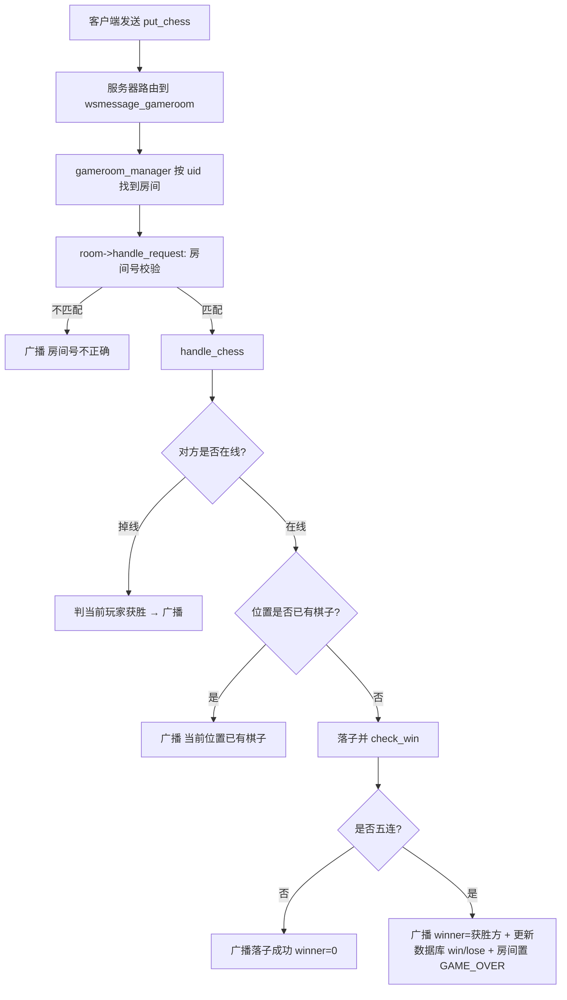
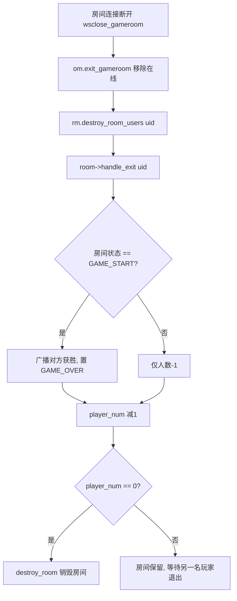

# 游戏房间管理模块

## 1. 模块概述

匹配成功的两名玩家将被创建进一个**游戏房间（gameroom）**，房间在两名玩家之间建立起小范围的关联：房间内一个玩家的动作（下棋 / 聊天 / 退出）会**广播**给房间内的另一名玩家。同时，服务器可能存在多个房间，因此需要**房间管理器（gameroom_manager）**对房间进行统一管理，控制房间的创建、查找与销毁（生命周期）。

- 涉及文件：`gameroom.hpp`
- 依赖：`db.hpp`（`user_table`，胜负结算）、`util.hpp`（`Json_Util`）、`online.hpp`（`online_manager`，取连接 / 判在线）

## 2. 模块设计思路

- **为什么需要房间**：匹配只解决「谁和谁对战」，对局过程（轮流下棋、聊天、判胜负）需要一个独立的上下文来承载，房间即为此而生。
- **房间的粒度**：一个房间恰好包含**两名玩家**（先匹配到的为白棋 `_white_id`，后匹配到的为黑棋 `_black_id`）与一张 **15 × 15 棋盘**。
- **房间内消息的传播**：房间内产生的所有消息统一通过 `broadcast` 广播给双方——发送方与接收方收到的内容一致（发送方由客户端本地优化展示）。
- **房间生命周期的控制**：
  - 创建：两玩家匹配成功 → `create_room`；
  - 运行：两名玩家建立房间 WebSocket 连接后对局；
  - 销毁：所有玩家退出房间（`_player_num == 0`）→ `destroy_room`。

## 3. gameroom 类的设计（单个房间）

### 3.1 常量与状态枚举

```cpp
#define BORAD_ROW 15   // 棋盘行数（代码中的拼写为 BORAD）
#define BORAD_COL 15   // 棋盘列数
#define CHESS_WHITE 1  // 白棋标记
#define CHESS_BLACK 2  // 黑棋标记

typedef enum
{
    GAME_START, // 游戏中
    GAME_OVER   // 游戏结束
} room_statu;   // 房间状态：决定玩家退出房间时所做的动作
```

### 3.2 数据成员

| 成员 | 类型 | 说明 |
| ---- | ---- | ---- |
| `_room_id` | `uint64_t` | 房间 ID（唯一） |
| `_statu` | `room_statu` | 房间状态（`GAME_START` / `GAME_OVER`），决定玩家退出时的动作 |
| `_player_num` | `int` | 房间内玩家数量，**为 0 时房间被销毁** |
| `_white_id` | `uint64_t` | 白棋玩家 ID |
| `_black_id` | `uint64_t` | 黑棋玩家 ID |
| `_player_table` | `user_table *` | 数据管理模块句柄，玩家胜 / 负时更新用户信息表 |
| `_online_user` | `online_manager *` | 在线用户管理句柄（判断在线、获取连接） |
| `_board` | `vector<vector<int>>` | 15 × 15 棋盘，`0` 空 / `1` 白 / `2` 黑 |

### 3.3 接口总览

```cpp
class gameroom
{
    private:
        // ...数据成员见 3.2...
        bool five(int row, int col, int row_offset, int col_offset, int color); // 单方向连子统计
        uint64_t check_win(int row, int col, int color); // 四方向判定是否胜利，返回赢家ID

    public:
        gameroom(uint64_t room_id, user_table *player_table, online_manager *online_user);
        ~gameroom();
        uint64_t get_room_id();        // 获取房间ID
        room_statu get_statu();        // 获取房间状态
        int player_num();              // 获取房间内玩家数量
        void add_white_user(uint64_t uid); // 加入白棋玩家（_player_num++）
        void add_black_user(uint64_t uid); // 加入黑棋玩家（_player_num++）
        uint64_t get_white_id();       // 获取白棋玩家ID
        uint64_t get_black_id();       // 获取黑棋玩家ID

        Json::Value handle_chess(Json::Value &req); // 处理下棋，返回响应
        Json::Value handle_chat(Json::Value &req);  // 处理聊天，返回响应
        void handle_exit(uint64_t uid);             // 处理玩家退出
        void handle_request(Json::Value &req);      // 请求分发入口（下棋 / 聊天）
        void broadcast(Json::Value &rsp);           // 将响应广播给房间内两名玩家
};
```

- 构造函数初始化 `_statu = GAME_START`、`_player_num = 0`，并把 `_board` 初始化为 15 × 15 的全 0 矩阵；构造 / 析构时打印 `房间创建成功 / 房间销毁成功` 日志。

### 3.4 请求分发入口（handle_request）

```cpp
void handle_request(Json::Value &req)
```

1. **房间号校验**：取 `req["room_id"]`，与自身 `_room_id` 不符 → 广播 `{"result":false,"reason":"房间号不正确"}` 并结束；
2. 按 `req["optype"]` 分发：

| optype | 处理函数 | 附加处理 |
| ------ | -------- | -------- |
| `put_chess` | `handle_chess` | 若响应中 `winner != 0`：对赢家调 `win`、输家调 `lose` 更新数据库，并将房间置为 `GAME_OVER` |
| `chat` | `handle_chat` | — |
| 其他 | — | 广播 `{"result":false,"reason":"未知请求类型"}` |

3. 将响应 `broadcast` 广播给双方。

### 3.5 下棋处理（handle_chess）

```cpp
Json::Value handle_chess(Json::Value &req)
```

请求中至少携带：`uid`（当前玩家）、`row` / `col`（落子位置）；响应以 `req` 为基底构造，自动带出上述字段。处理流程：

1. **对方在线校验**：若白方不在房间在线表中 → 黑方直接获胜（`"对方掉线，你获得胜利！"`）；反之同理；
2. **落子合法性校验**：`_board[row][col] != 0`（已有棋子）→ `{"result":"false","reason":"当前位置已有棋子！"}`；
3. **落子**：根据 `cur_id` 与白 / 黑 ID 的比对确定棋子颜色，写入棋盘；
4. **胜负判定**：`check_win(row, col, cur_color)`，若存在赢家则补充 `reason = "五星连珠！获得胜利"`；
5. 统一返回 `{"optype":"put_chess","result":"true","winner":<赢家ID或0>, ...}`。

**胜负判定实现（five / check_win）**：

```cpp
bool five(int row, int col, int row_offset, int col_offset, int color)
// 从 (row,col) 出发，沿 (row_offset,col_offset) 及其反方向统计同色连续棋子数，
// 越过棋盘边界或遇到异色/空位即停止，返回是否达到 5 连。

uint64_t check_win(int row, int col, int color)
// 对刚落下的棋子，在四个方向做连子判定：
//   横向 (0,1) | 纵向 (1,0) | 右上斜线 (-1,1) | 左上斜线 (-1,-1)
// 任一方向 five 成立 → 返回该颜色对应玩家的 ID；否则返回 0。
```

### 3.6 聊天处理（handle_chat）

```cpp
Json::Value handle_chat(Json::Value &req)
```

请求中携带：`uid`、`message`。处理流程：

1. 取 `req["message"]` 做**敏感词过滤**（当前仅检查是否包含字符「菜」）；
2. 命中敏感词 → `{"result":"false","reason":"聊天内容包含敏感词"}`；
3. 未命中 → `{"result":"true"}`，消息随响应广播给双方。

### 3.7 玩家退出处理（handle_exit）

```cpp
void handle_exit(uint64_t uid)
```

在玩家退出房间（WebSocket 断开）时被调用：

1. 若房间状态为 `GAME_START`（**中途退出**）：构造 `{"optype":"put_chess","result":"true","reason":"对方已退出游戏，你获得胜利！","row":-1,"col":-1,"winner":<另一名玩家>}` 并广播，通知对方获胜，随后将房间置为 `GAME_OVER`；
2. `_player_num--`（玩家数量减少，为房间销毁的判断依据）。

### 3.8 广播（broadcast）

```cpp
void broadcast(Json::Value &rsp)
```

1. 将响应 `Json::Value` 序列化为字符串；
2. 通过 `_online_user->get_conn_gameroom` 分别获取白方、黑方的连接，连接非空则 `send` 消息。

## 4. gameroom_manager 类的设计（房间管理器）

```cpp
using room_ptr = std::shared_ptr<gameroom>; // 房间使用智能指针管理，便于自动释放

class gameroom_manager
{
    private:
        uint64_t _next_room_id;                          // 房间ID分配计数器（从1自增，唯一）
        user_table *_player_table;                       // 数据管理模块句柄
        online_manager *_online_user;                    // 在线用户管理模块句柄
        std::mutex _mutex;                               // 互斥锁
        std::unordered_map<uint64_t, room_ptr> _rooms;   // 房间ID -> 房间信息
        std::unordered_map<uint64_t, uint64_t> _users_rooms; // 用户ID -> 房间ID

    public:
        gameroom_manager(user_table *player_table, online_manager *online_user);
        room_ptr create_room(uint64_t uid1, uint64_t uid2); // 创建房间
        room_ptr get_room_by_roomid(uint64_t room_id);      // 按房间ID查找
        room_ptr get_room_by_userid(uint64_t uid);          // 按用户ID查找所在房间
        void destroy_room(uint64_t room_id);                // 按房间ID销毁
        void destroy_room_users(uint64_t uid);              // 用户退出时删除，空则销毁房间
};
```

### 4.1 创建房间（create_room）

```cpp
room_ptr create_room(uint64_t uid1, uint64_t uid2)
```

由匹配模块在**匹配成功**后调用。处理流程：

1. 校验两名玩家都还在游戏大厅（`is_in_gamehall`），否则拒绝创建并返回空 `room_ptr`；
2. 加锁，创建 `gameroom` 对象，`uid1` 为白棋、`uid2` 为黑棋（`add_white_user` / `add_black_user`）；
3. 登记映射：`_rooms[房间ID] = 房间`，`_users_rooms[uid1/uid2] = 房间ID`；
4. `_next_room_id++`，返回 `room_ptr`。

### 4.2 查找房间

- **`get_room_by_roomid`**：`_rooms` 中按房间 ID 查找；未找到打印 `房间不存在` 并返回空 `room_ptr`。
- **`get_room_by_userid`**：先在 `_users_rooms` 中按用户 ID 找到房间 ID，再到 `_rooms` 中取房间；任一环节失败均返回空 `room_ptr`。用于服务器模块把房间消息路由到正确的房间、房间连接建立时校验玩家是否有房间。

### 4.3 销毁房间

- **`destroy_room(room_id)`**：取房间 → 拿到白 / 黑玩家 ID → 从 `_users_rooms` 移除两名玩家 → 从 `_rooms` 删除房间。由于房间由 `shared_ptr` 管理，从映射中移除后无人引用即自动释放。
- **`destroy_room_users(uid)`**：用户 WebSocket 断开时调用。取用户所在房间 → `handle_exit(uid)`（对方判胜 / 人数-1）→ 若 `player_num() == 0`（双方都退出）再调用 `destroy_room` 销毁房间。

## 5. 房间生命周期与关键流程

### 5.1 房间生命周期

```mermaid
stateDiagram-v2
    [*] --> 创建: 匹配成功 Matcher::create_room
    创建 --> 游戏中: 双方建立 /room 连接
    游戏中 --> 游戏结束: 产生赢家 / 有人中途退出
    游戏结束 --> 待销毁: 玩家陆续退出(handle_exit)
    游戏中 --> 待销毁: 玩家退出
    待销毁 --> [*]: player_num==0 → destroy_room
```

### 5.2 下棋流程



### 5.3 玩家中途断线流程



## 6. 涉及文件与依赖

- 涉及文件：`gameroom.hpp`（`gameroom` 与 `gameroom_manager` 两个类）
- 依赖：
  - `db.hpp`：`user_table`（胜利 `win` / 失败 `lose` 结算）
  - `util.hpp`：`Json_Util`（响应序列化）
  - `online.hpp`：`online_manager`（在线判断 `is_in_gameroom`、连接获取 `get_conn_gameroom`）
  - `logger.hpp`（日志输出）
  - C++ 标准库：`<vector>`、`<string>`、`<unordered_map>`、`<memory>`、`<mutex>`
      