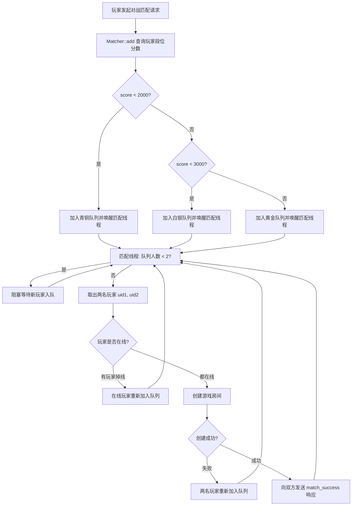

# 玩家匹配模块设计

## 1. 模块概述

匹配模块用于将**发起对战匹配请求**的玩家，根据其**段位分数**归入对应等级的匹配队列，由专门的匹配线程从队列中取出玩家两两配对；配对成功后为双方创建游戏房间，并向两个玩家的客户端发送匹配成功响应。

- 涉及文件：`matcher.hpp`
- 依赖：`util.hpp`、`gameroom.hpp`、`db.hpp`、`online.hpp`、`logger.hpp`（及标准线程库）

## 2. 模块设计思路

- **为什么需要匹配模块**：玩家登录后进入游戏大厅，发起"对战匹配请求"后，服务器需要为玩家寻找一位实力相近的对手。匹配模块负责维护多个等级的等待队列，并持续尝试将队列中的玩家两两配对，配对成功后把玩家交给游戏房间管理模块创建房间。
- **按段位分队列**：为避免实力悬殊的玩家被匹配到一起，依据玩家的段位分数 `score` 划分三个等级的匹配队列：

| 队列 | 分数区间 | 说明 |
| ---- | -------- | ---- |
| 青铜队列 `_queue_bronze` | `score < 2000` | 低分段玩家 |
| 白银队列 `_queue_silver` | `2000 <= score < 3000` | 中分段玩家 |
| 黄金队列 `_queue_gold` | `score >= 3000` | 高分段玩家 |

- **阻塞队列 + 条件变量**：每个等级队列由独立的匹配线程消费。队列为空或不足两人时线程阻塞等待；有新玩家入队时通过条件变量唤醒线程，实现"有人排队就立即尝试配对"的效果。
- **线程模型**：为每个等级队列各启动一个匹配线程（`_thread_bronze` / `_thread_silver` / `_thread_gold`），三个队列互不干扰、并行匹配。

## 3. 匹配队列的封装实现（Match_Queue）

匹配队列是泛型模板类，供三个等级队列复用。内部使用**链表**而非 `std::queue`，因为匹配取消（`del`）需要从队列中间删除元素；使用**互斥锁 + 条件变量**实现线程安全的阻塞队列。

```cpp
template <class T>
class Match_Queue
{
    private:
        std::list<T> _list;              // 存储队列元素（链表，支持中间删除）
        std::mutex _mutex;               // 互斥锁，保护队列操作的线程安全
        std::condition_variable _cond;   // 条件变量，实现阻塞等待与唤醒

    public:
        int size();                      // 获取队列中元素个数
        bool empty();                    // 判断队列是否为空
        void wait();                     // 阻塞等待队列非空（条件变量等待）
        void push(const T &data);        // 数据入队，唤醒等待的匹配线程
        bool pop(T &data);               // 数据出队（取出队首元素）
        bool remove(T &data);            // 从队列中间删除指定元素
};
```

### 3.1 各接口说明

- **`size()` / `empty()`**：加锁后返回队列元素个数 / 是否为空，供匹配线程判断队列状态。
- **`wait()`**：加锁后调用 `_cond.wait(lock)` 阻塞当前线程，直到有其他线程 `push` 入队并 `notify_all` 唤醒。
- **`push(const T &data)`**：加锁后将元素尾插到链表，并调用 `_cond.notify_all()` 唤醒正在 `wait` 的匹配线程。
- **`pop(T &data)`**：加锁后若队列为空直接返回 `false`；否则取出队首元素并删除，返回 `true`。
- **`remove(T &data)`**：加锁后调用 `_list.remove(data)`，将指定元素从队列中间移除（用于玩家取消匹配）。

## 4. 匹配器（Matcher）的封装实现

```cpp
class Matcher
{
    private:
        std::mutex _mutex;                 // 互斥锁
        std::condition_variable _cond;     // 条件变量
        Match_Queue<uint64_t> _queue_bronze; // 青铜匹配队列
        Match_Queue<uint64_t> _queue_silver; // 白银匹配队列
        Match_Queue<uint64_t> _queue_gold;   // 黄金匹配队列
        std::thread _thread_bronze;        // 青铜队列匹配线程
        std::thread _thread_silver;        // 白银队列匹配线程
        std::thread _thread_gold;          // 黄金队列匹配线程
        gameroom_manager *_rm;             // 游戏房间管理模块句柄
        user_table *_ut;                   // 数据管理模块句柄
        online_manager *_om;               // 在线用户管理模块句柄

    private:
        void handle_match(Match_Queue<uint64_t> &mq); // 匹配处理主循环
        void th_bronze_entry();            // 青铜匹配线程入口
        void th_silver_entry();            // 白银匹配线程入口
        void th_gold_entry();              // 黄金匹配线程入口

    public:
        Matcher(gameroom_manager *rm, user_table *ut, online_manager *om);
        bool add(uint64_t uid);            // 玩家加入匹配队列
        bool del(uint64_t uid);            // 玩家取消匹配（移出队列）
};
```

### 4.1 构造与初始化

- 构造函数接收三个句柄：`gameroom_manager *rm`（创建房间）、`user_table *ut`（查询玩家段位分数）、`online_manager *om`（校验玩家是否在线）。
- 通过初始化列表为三个匹配线程分别绑定 `th_bronze_entry` / `th_silver_entry` / `th_gold_entry`，构造完成即启动三个匹配线程。
- 初始化完成后打印 `"匹配模块初始化完毕"` 日志。

### 4.2 匹配处理主循环（handle_match）

匹配线程的核心逻辑，处理流程如下：

1. **等待玩家**：当队列人数不足 2 人时，调用 `mq.wait()` 阻塞等待，直到有玩家入队。
2. **取出两名玩家**：从队列中 `pop` 出玩家 A 的 uid；若弹出失败（队列被清空）则继续循环；再 `pop` 玩家 B 的 uid，若失败则将玩家 A 重新 `add` 回队列，避免玩家丢失。
3. **在线校验**：分别通过 `_om->get_conn_gamehall(uid)` 获取两名玩家在游戏大厅中的 WebSocket 连接，并判断连接是否为空：
   - 玩家 A 掉线：将玩家 B 重新加入队列，继续循环；
   - 玩家 B 掉线：将玩家 A 重新加入队列，继续循环。
4. **创建房间**：调用 `_rm->create_room(uid1, uid2)` 为两名玩家创建游戏房间；创建失败则将两名玩家都重新加入队列。
5. **通知客户端**：构造 `optype = "match_success"`、`result = true` 的 JSON 响应，序列化后分别通过两个玩家的连接 `send` 给客户端，随后进入下一轮循环。

```cpp
void handle_match(Match_Queue<uint64_t> &mq)
{
    while (true)
    {
        // 1. 队列人数不足2人则阻塞等待
        while (mq.size() < 2)
        {
            mq.wait();
        }
        // 2. 取出两名玩家
        uint64_t uid1;
        if (mq.pop(uid1) == false) continue;
        uint64_t uid2;
        if (mq.pop(uid2) == false) { this->add(uid1); continue; }
        // 3. 校验玩家是否在线，掉线则把另一名玩家重新加入队列
        websocket_server::connection_ptr conn1 = _om->get_conn_gamehall(uid1);
        if (conn1.get() == nullptr) { this->add(uid2); continue; }
        websocket_server::connection_ptr conn2 = _om->get_conn_gamehall(uid2);
        if (conn2.get() == nullptr) { this->add(uid1); continue; }
        // 4. 为两名玩家创建游戏房间
        room_ptr rp = _rm->create_room(uid1, uid2);
        if (rp == nullptr) { this->add(uid1); this->add(uid2); continue; }
        // 5. 向两名玩家发送匹配成功响应
        Json::Value resp;
        resp["optype"] = "match_success";
        resp["result"] = true;
        std::string body;
        Json_Util::serialize(resp, body);
        conn1->send(body);
        conn2->send(body);
    }
}
```

### 4.3 加入匹配队列（add）

```cpp
bool add(uint64_t uid);
```

处理流程：

1. 通过 `_ut->select_by_id(uid, user)` 查询玩家信息，查询失败打印错误日志并返回 `false`。
2. 读取玩家的段位分数 `user["score"]`，按分数区间将 uid 压入对应的匹配队列（青铜 / 白银 / 黄金）。

### 4.4 取消匹配（del）

```cpp
bool del(uint64_t uid);
```

处理流程：

1. 同样先通过 `_ut->select_by_id(uid, user)` 查询玩家信息，查询失败返回 `false`。
2. 根据分数区间确定玩家所在的队列，调用对应 `Match_Queue::remove(uid)` 将该玩家从队列中间移除（利用链表中间删除能力），实现停止匹配。

## 5. 匹配流程



## 6. 实现要点

### 6.1 线程安全
- 匹配队列内部所有操作均通过 `std::mutex` 加锁保护，防止多个匹配线程 / 业务线程并发读写队列造成数据竞争。
- 匹配线程通过 `std::condition_variable` 实现阻塞等待，避免忙等待浪费 CPU。

### 6.2 阻塞队列的设计取舍
- 使用 `std::list` 而非 `std::queue`：`del` 取消匹配时需要从队列**中间**删除指定元素，链表天然支持该操作。
- `push` 时 `notify_all` 唤醒等待线程，保证"入队即触发匹配"。

### 6.3 出队失败的兜底处理
- 匹配线程取出玩家 A 后，若玩家 B 弹出失败（例如队列恰好被清空），必须将玩家 A 重新 `add` 回队列，防止玩家被"凭空丢失"。
- 在线校验 / 创建房间失败时同样将玩家重新入队，保证玩家不会因为偶发异常而永久停留在"匹配中"。

### 6.4 在线校验的必要性
- 玩家可能已退出大厅但尚未从队列移除（网络波动等情况），因此匹配前必须通过 `online_manager::get_conn_gamehall` 校验双方在线，掉线玩家不参与配对，且在线一方需重新入队继续等待。

### 6.5 匹配成功通知
- 匹配成功后向双方发送 `optype = "match_success"` 的 JSON 响应，客户端据此跳转到游戏房间页面并建立游戏房间的 WebSocket 长连接。

### 6.6 补充说明

- **新玩家进入青铜队列**：新注册用户的段位分数初始为 `1000`（见数据管理模块），因此默认归入青铜队列；随着胜负结算分数在 `score ± 30` 之间变化，玩家会自动跨入 / 跨出对应队列。
- **队列的隔离性**：三个等级队列各自持有独立的互斥锁与条件变量，匹配线程之间互不干扰，可并行配对。
- **已声明但未使用的成员**：`Matcher` 类中声明的 `_mutex` 与 `_cond` 在现有实现中并未被使用（匹配队列内部自带锁与条件变量），属于可清理的冗余成员。

## 7. 涉及文件与依赖

- 涉及文件：`matcher.hpp`
- 依赖：
  - `util.hpp`（`Json_Util` 序列化）
  - `gameroom.hpp`（`gameroom_manager` 创建房间、`room_ptr`）
  - `db.hpp`（`user_table` 查询段位分数）
  - `online.hpp`（`online_manager` 获取连接 / 校验在线）
  - `logger.hpp`（日志输出）
  - C++ 标准库：`<list>`、`<mutex>`、`<condition_variable>`、`<thread>`
