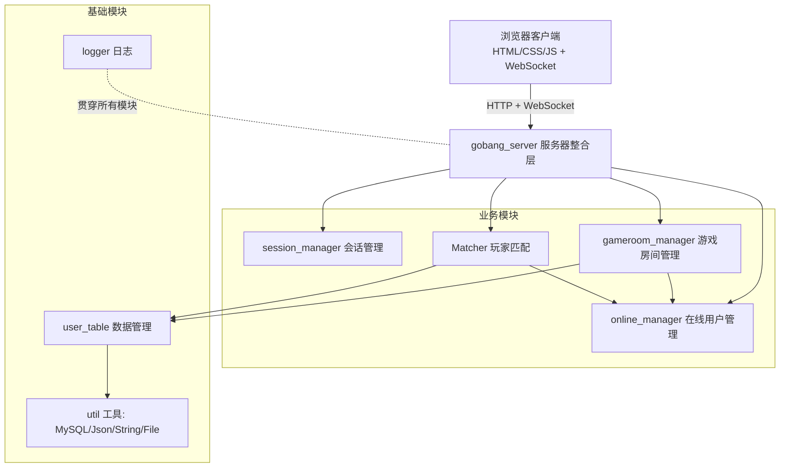
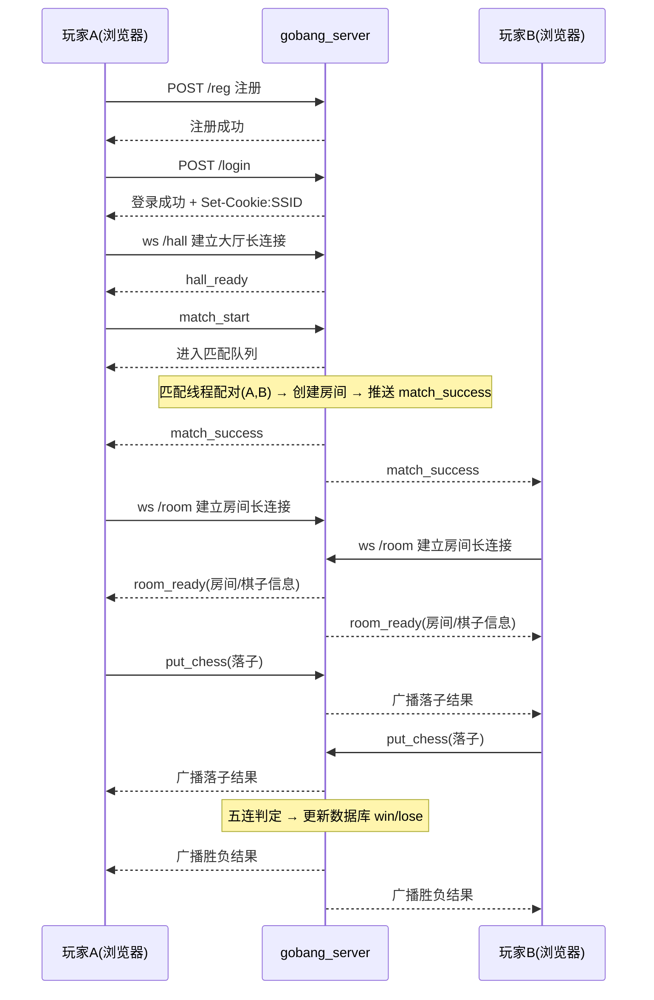

# 五子棋对战平台 —— 项目总结

> 项目名称：基于 WebSocket 的多用户网页五子棋游戏

## 1. 项目简介

本项目是一个基于 **C++ 与 WebSocket** 的在线五子棋对战平台：玩家通过浏览器访问服务器，完成 **注册 / 登录** 后进入游戏大厅，发起**段位匹配**；匹配成功后双方进入同一游戏房间，在 15 × 15 棋盘上**轮流落子对战**，并支持**房间内实时聊天**。对局胜负会实时结算到 MySQL 中的玩家段位分数，实现「匹配 — 对局 — 升降分」的完整闭环。

## 2. 技术栈

| 层次 | 技术 |
| ---- | ---- |
| 开发系统 | Linux-Ubuntu |
| 服务端语言 | C++11 |
| 网络框架 | websocketpp（asio，同时承载 HTTP 与 WebSocket，提供定时器） |
| 数据库 | MySQL（C API：`libmysqlclient`） |
| JSON | jsoncpp |
| 客户端 | HTML / CSS / JavaScript + jQuery + WebSocket |
| 构建 | makefile（`g++ -std=c++11`） |
| 并发 | C++ 标准线程 / 互斥锁 / 条件变量 |


## 3. 功能总览与请求接口

### 3.1 功能点

- 用户注册、登录（密码经 MySQL `PASSWORD()` 加密存储）
- Cookie + Session 的身份识别与会话生命周期管理
- 按段位分数分档（青铜 / 白银 / 黄金）的自动对战匹配
- 15 × 15 五子棋对局：落子、四方向五连判定、胜负结算
- 房间内实时聊天（含基础敏感词过滤）
- 中途断线自动判负、退出房间自动销毁房间

### 3.2 客户端请求一览

| # | 请求 | 通道 |
| - | ---- | ---- |
| 1 | 获取注册页面 `GET /register.html` | HTTP |
| 2 | 提交注册 `POST /reg` | HTTP |
| 3 | 获取登录页面 `GET /login.html` | HTTP |
| 4 | 提交登录 `POST /login`（下发 `Set-Cookie: SSID`） | HTTP |
| 5 | 获取游戏大厅页面 `GET /game_hall.html` | HTTP |
| 6 | 获取用户信息 `GET /info` | HTTP |
| 7 | 建立游戏大厅长连接 `ws /hall` | WebSocket |
| 8 | 发起匹配 `{"optype":"match_start"}` | WebSocket |
| 9 | 停止匹配 `{"optype":"match_stop"}` | WebSocket |
| 10 | 获取游戏房间页面 `GET /game_room.html` | HTTP |
| 11 | 建立游戏房间长连接 `ws /room` | WebSocket |
| 12 | 下棋 `{"optype":"put_chess",...}` | WebSocket |
| 13 | 聊天 `{"optype":"chat",...}` | WebSocket |
| 14 | 游戏结束返回大厅 `GET /game_hall.html` | HTTP |

> 完整协议格式与处理细节见《封装服务器模块设计》。

## 4. 系统架构与模块划分



| 模块 | 对应文件 | 设计文档 | 职责 |
| ---- | -------- | -------- | ---- |
| 服务器整合 | `server.hpp`、`gobang.cc` | 封装服务器模块设计 | 搭建 websocketpp 服务器，HTTP / WebSocket 请求分发与业务编排 |
| 会话管理 | `session.hpp` | 会话模块设计 | 登录状态与 Cookie(SSID) 关联、会话超时 / 永久生命周期 |
| 数据管理 | `db.hpp`、`db.sql` | 数据管理模块设计 | 用户表的注册、登录校验、查询、胜负结算 |
| 在线用户管理 | `online.hpp` | 在线用户管理模块设计 | 维护大厅 / 房间中 uid 与 WebSocket 连接的映射 |
| 游戏房间管理 | `gameroom.hpp` | 游戏房间管理模块 | 房间创建 / 查找 / 销毁，落子判定、广播、胜负结算 |
| 玩家匹配 | `matcher.hpp` | 玩家匹配模块设计 | 分档阻塞队列 + 独立线程两两配对，成功后创建房间 |
| 工具模块 | `util.hpp` | 工具模块设计 | MySQL / JSON / 字符串分割 / 文件读取封装 |
| 日志模块 | `logger.hpp` | 日志模块设计 | 带线程 / 时间 / 文件 / 行号的日志输出宏 |

## 5. 一次完整对局的核心流程



## 6. 核心设计亮点

1. **会话生命周期的「临时 ⇄ 永久」切换**：HTTP 阶段会话 30 秒无通信即删除；进入大厅 / 房间后转为永久；退出后恢复临时。定时器 `cancel()` 不保证立即生效，因此切换时通过 `set_timer(0, append_session)` 将会话重新插入管理器，防止被残留的删除回调误删。
2. **防重复登录**：大厅 / 房间连接建立时，通过 `online_manager::is_in_*` 检查用户是否已在其他连接上，重复登录直接拒绝（因此客户端匹配成功跳转房间前需先断开大厅连接）。
3. **按段位分档的阻塞匹配**：青铜 / 白银 / 黄金三个队列各由一个独立线程消费；采用 `std::list` 支持从中间删除（取消匹配），条件变量实现「有人排队即唤醒」。出队、掉线、建房失败都有**重新入队兜底**，保证玩家不会凭空丢失。
4. **房间自治 + 广播模型**：房间内的下棋 / 聊天 / 退出均统一经由 `handle_request` → `broadcast` 广播给双方；下棋前校验对方在线，掉线直接判胜，避免死等。
5. **智能指针管理生命周期**：会话、房间均以 `shared_ptr` 管理并存放于哈希表，从容器移除后自动释放，无手动 `delete`。
6. **模块句柄注入**：各模块通过构造函数注入依赖（`gameroom_manager`、`Matcher` 等），职责单一、便于替换测试。

## 7. 数据库设计

```sql
create table if not exists users (
    id int primary key auto_increment,
    username varchar(32) unique key not null,
    password varchar(128) not null,
    score int,          -- 段位分数，注册时初始化为 1000
    total_count int,    -- 总场数
    win_count int       -- 胜场数
);
```

- 段位分档：青铜 `score < 2000`、白银 `2000 <= score < 3000`、黄金 `score >= 3000`
- 结算规则：胜 `score + 30`（胜场 +1）、负 `score - 30`，双方 `total_count + 1`

## 8. 目录结构

```
source/
├── db.hpp / db.sql          # 数据管理模块 + 建库建表脚本
├── gameroom.hpp             # 游戏房间管理模块
├── logger.hpp               # 日志模块
├── matcher.hpp              # 玩家匹配模块
├── online.hpp               # 在线用户管理模块
├── server.hpp               # 服务器整合层
├── session.hpp              # 会话模块
├── util.hpp                 # 工具模块
├── gobang.cc / gobang       # 程序入口 / 编译产物
├── makefile                 # 构建脚本
├── wwwroot/                 # 前端静态资源(html/css/js/jquery)
└── 开发设计文档/             # 各模块设计文档与本文档
```

## 9. 构建与运行

```bash
# 1. 准备数据库（导入建表脚本）
mysql -uroot -p123456 < db.sql

# 2. 编译（需要 mysql、jsoncpp 开发库，及 websocketpp 头文件）
make

# 3. 启动服务器（默认监听 9002 端口，数据库 127.0.0.1:3306 root/123456/gobang）
./gobang

# 4. 浏览器访问
#    http://127.0.0.1:9002/   → 自动跳转登录页
```

> 依赖说明：websocketpp 需要 `-std=c++11` 及以上编译；若系统中 websocketpp / mysql / jsoncpp 头文件路径不同，需相应调整 makefile 与各头文件的包含路径。

## 10. 已知问题与改进方向

| 类别 | 现状 | 建议 |
| ---- | ---- | ---- |
| SQL 注入 | 使用 `sprintf` 直接拼接用户输入 | 改用预处理语句 / 参数绑定，或对输入转义 |
| 密码加密兼容性 | 使用 MySQL `PASSWORD()`（MySQL 8.0 已移除该函数） | 服务端采用 `SHA2` / bcrypt 等自行加密后比对 |
| 并发写库 | `insert` / `win` / `lose` 未加锁，共享 `MYSQL` 句柄存在并发写风险 | 与查询一致地加锁，或改用连接池 |
| 中途掉线结算 | `handle_exit`（断线路径）只广播对方获胜，**未更新数据库** win/lose | 断线判负路径也应同步结算数据库 |
| 敏感词过滤 | 仅检查单个字符「菜」 | 引入词库 / 正则 / 更完整的过滤策略 |
| 冗余成员 | `Matcher` 中 `_mutex`、`_cond` 未使用 | 清理无用成员 |
| 杂项 | `user_table` 析构中 `_mysql == NULL;` 为无效表达式；`BORAD` 拼写笔误 | 修正为赋值 / 统一命名 `BOARD` |
| 前端交互 | 下棋、聊天结果依赖客户端本地渲染 | 可增加回合限制、悔棋、重开等玩法扩展 |

## 11. 开发文档索引

| 文档 | 对应模块 |
| ---- | -------- |
| [封装服务器模块设计](./封装服务器模块设计.markdown) | 服务器整合层 |
| [会话模块设计](./会话模块设计.markdown) | 会话管理 |
| [数据管理模块设计](./数据管理模块设计.markdown) | 数据管理 |
| [在线用户管理模块设计](./在线用户管理模块设计.markdown) | 在线用户管理 |
| [游戏房间管理模块](./游戏房间管理模块.markdown) | 游戏房间管理 |
| [玩家匹配模块设计](./玩家匹配模块设计.markdown) | 玩家匹配 |
| [工具模块设计](./工具模块设计.markdown) | 工具模块 |
| [日志模块设计](./日志模块设计.markdown) | 日志模块 |